# Vacuum

An 80s hardware UI kit for Nuxt, built on [Nuxt UI](https://ui.nuxt.com). Every component is a physical object: keys you press, lamps that light, screens behind smoked glass, label tape and paper. It adds SVG display components for vacuum fluorescent readouts: segment digits, dot-matrix text, bar-graph meters and annunciator lamps.

Live showcase: [vacuum.stjhn.xyz](https://vacuum.stjhn.xyz). Each pull request gets its own preview.

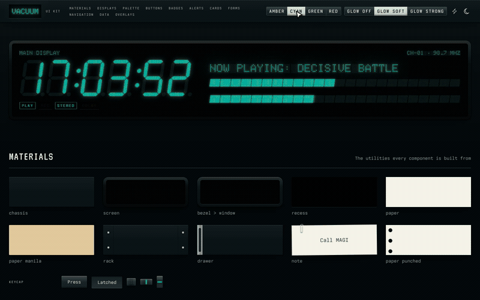

## Showcase

Each GIF shows one component in use. Static examples are JPEGs.

### Displays

**Segment display** — Seven- and fourteen-segment readouts, with a blinking clock.

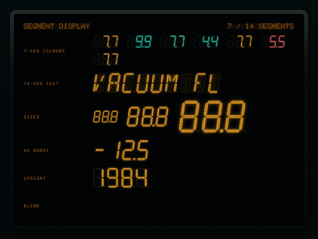

**Dot matrix** — Text drawn on a 5×7 grid, with round or square dots.

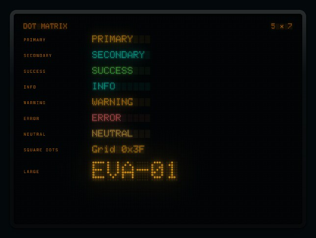

**Meter** — Live horizontal levels and a twelve-channel vertical meter bank.

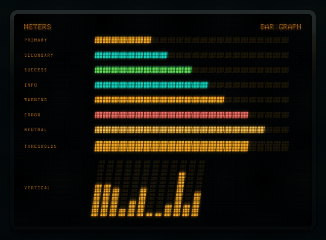

**Annunciator** — Click a lamp to toggle its illuminated legend; REC blinks when active.

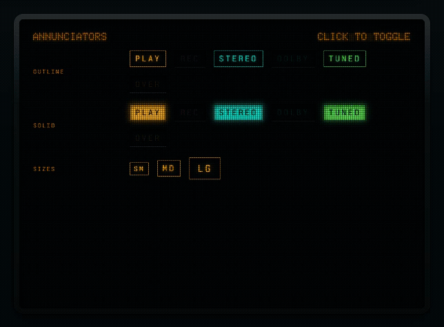

**Matrix text and icons** — The matrix font and icon filter beside the SVG display they match.

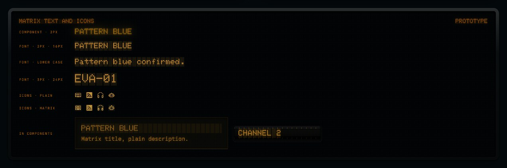

**Panel** — A moulded frame and smoked-glass window holding several readouts together.

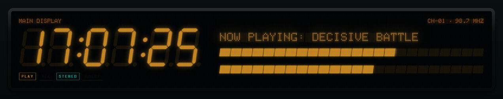

### Buttons and forms

**Button** — Hover and press the different keycap variants.

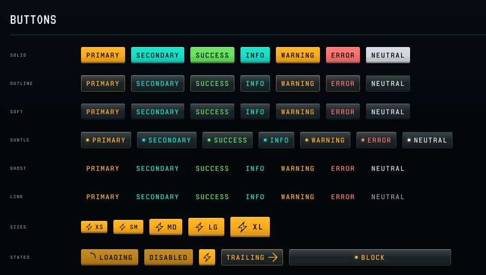

**Input** — Type into a framed screen; the shared value appears across all five variants.

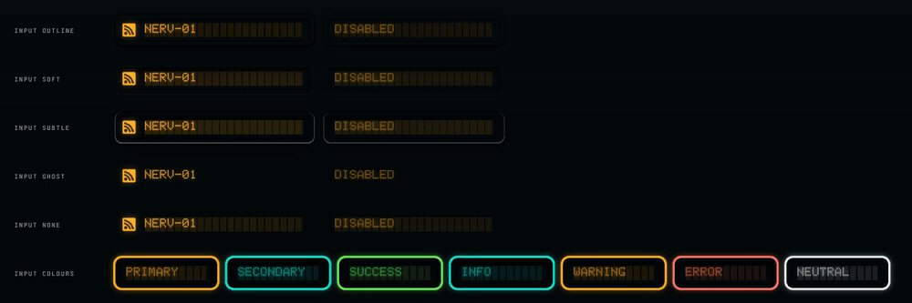

**Textarea** — Add lines to a continuous-feed teletype sheet.

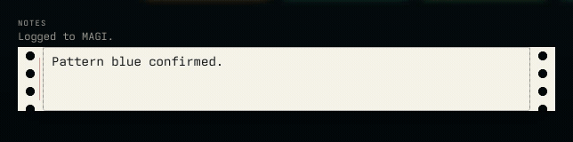

**Select** — Open the thumbwheel's display menu and choose another channel.

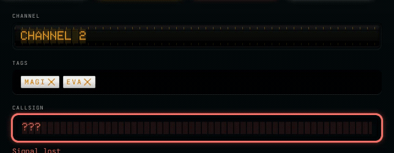

**Input tags** — Type a label, press Enter to cut a tape chip, and remove it with Backspace.

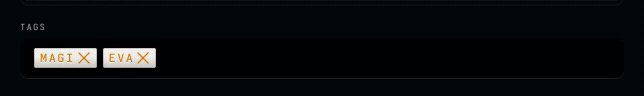

**Checkbox** — Press the lens to switch the tick and light ring on or off.

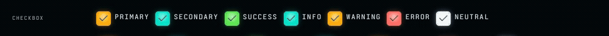

**Switch** — Move the chrome knob between its off and on detents.

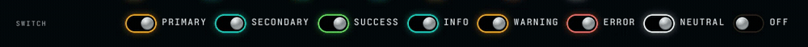

**Radio group** — Select one mode; the other keys release. Both examples share the same value.

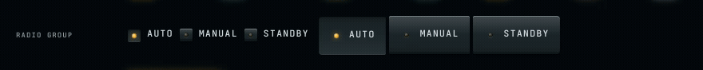

**Slider** — Drag the fader to change its level and segmented light trail.

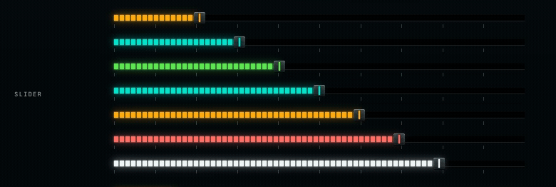

**Progress** — Segmented level bars, including an animated indeterminate indicator.

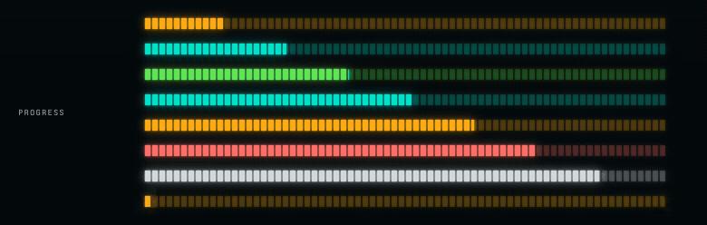

**Pin input** — Enter a four-digit code; focus advances between the counter keys.

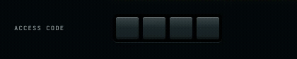

### Navigation

**Tabs** — Change audio sources using latching keys or the sliding tuner needle.

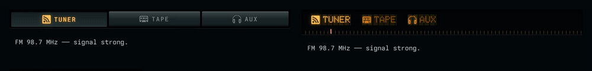

**Accordion** — Open and close a folder to reveal the paper filed inside.

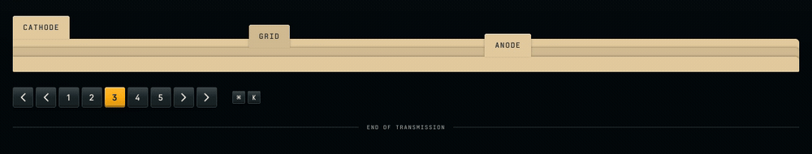

**Pagination** — Select a page or use the next and previous keys.

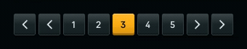

**Breadcrumb** — A path printed inside a smoked-glass display window.

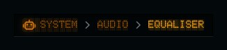

**Kbd** — A keyboard shortcut shown as a pair of physical keycaps.

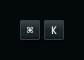

**Separator** — An etched rule with a printed legend.

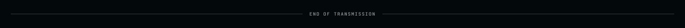

### Overlays

**Modal** — Open a rack-mount confirmation panel and press Launch to dismiss it.

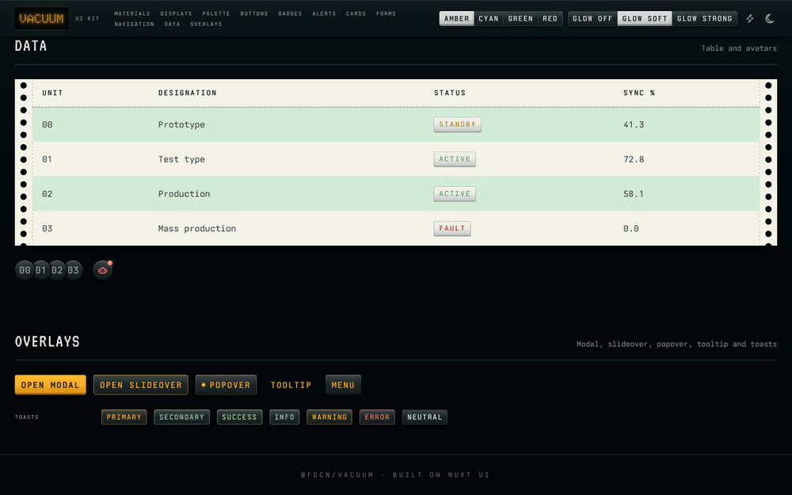

**Slideover** — Pull out a diagnostics drawer with live meters, then press CLOSE.

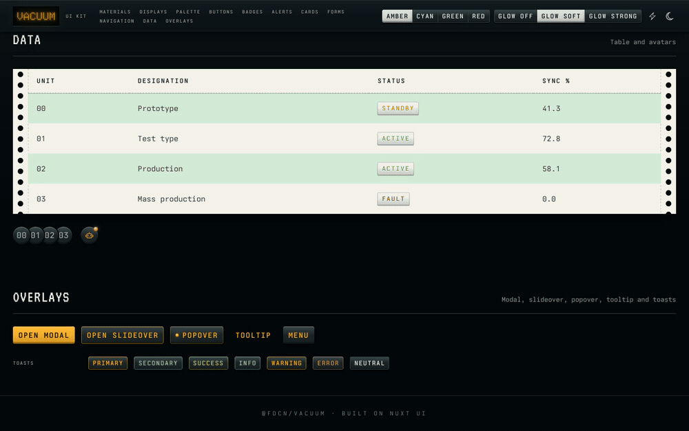

**Popover** — Open a clipped paper note and dismiss it with Escape.


**Tooltip** — Hover a control to reveal its small display window.

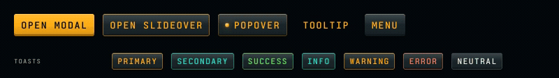

**Dropdown menu** — Open the VFD menu and move between its inverted selection rows.

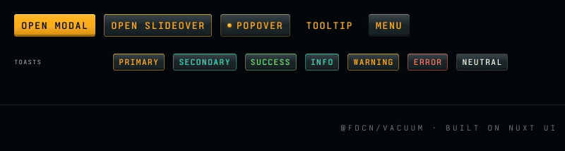

**Toast** — Trigger notifications in different signal colours.

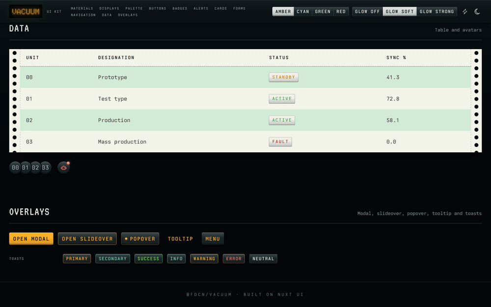

### Materials and static components

**Keycaps** — Press and release a plain key beside a latched one.

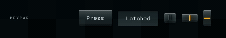

**Folder stack** — Switch between labelled files and close the open folder.

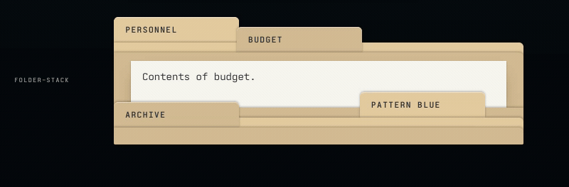

**Surfaces** — Chassis, smoked glass, recesses, rack metal and paper stock.

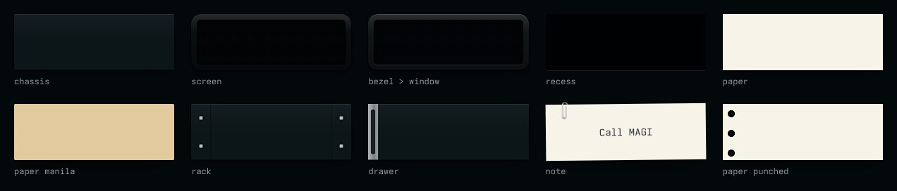

**Tape and lamps** — Embossed labels, chrome, tinted lenses and indicator LEDs.

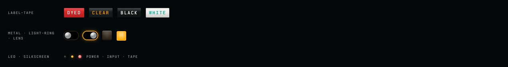

**Badges** — Dyed, clear, black and white label-maker tape.

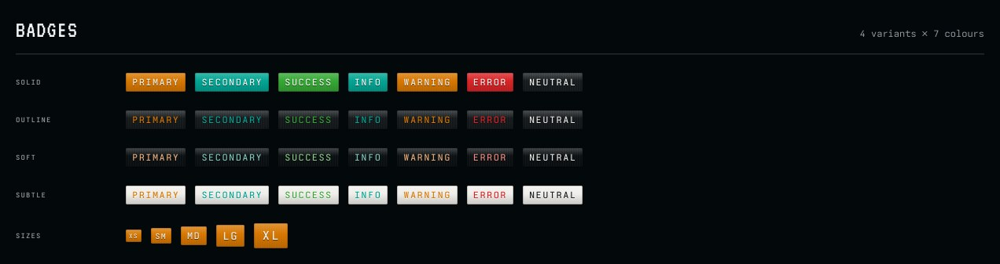

**Alerts** — Status messages behind coloured display glass.

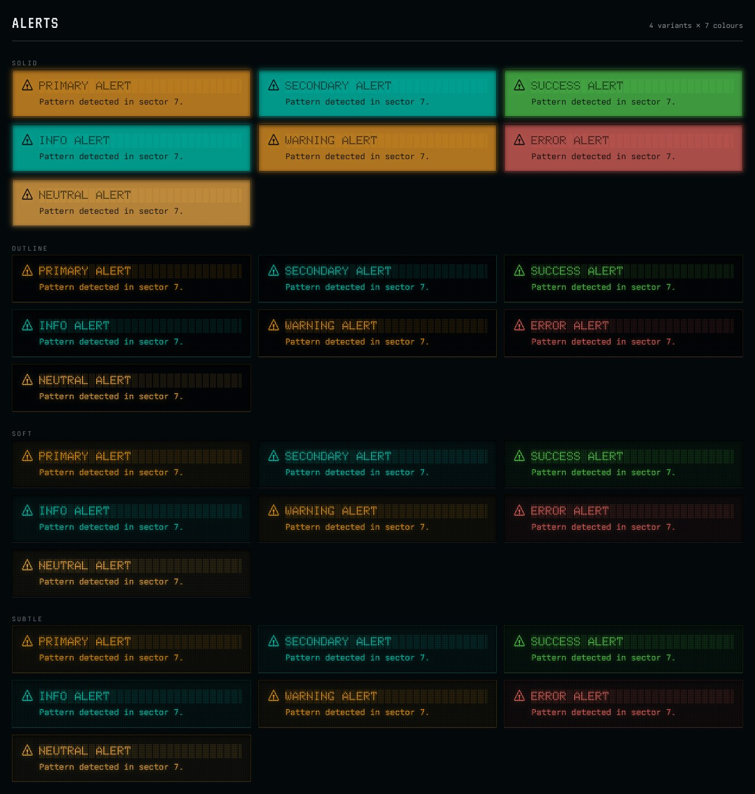

**Cards** — Framed display surfaces with keycap actions and tape status labels.

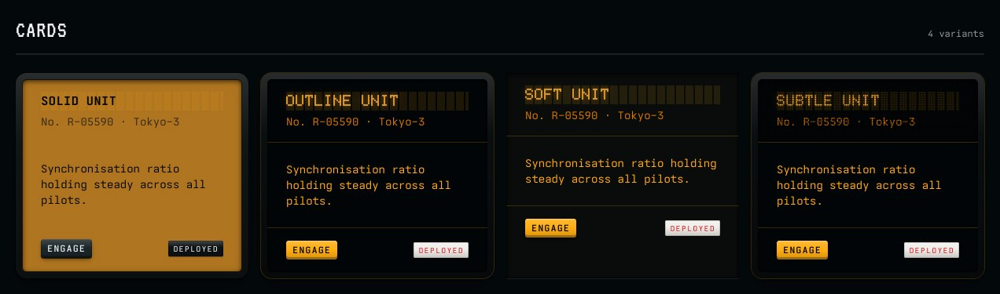

**Table** — A continuous-feed green-bar printout with tape status labels.

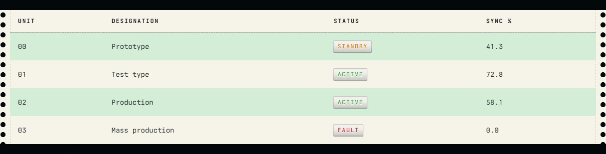

**Avatar, avatar group and chip** — Identity keys grouped together, with a small notification lamp.

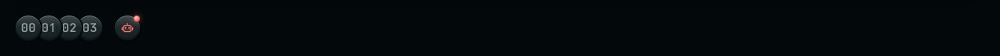

**Palette** — Four phosphor ramps and smoked-glass neutrals.

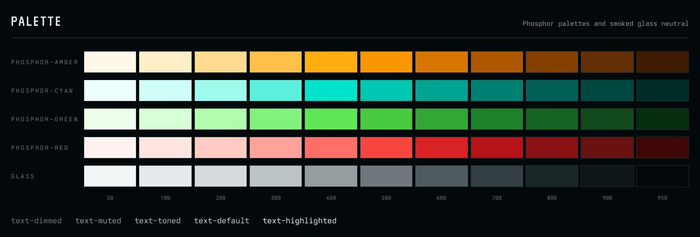

### Runtime controls

Change phosphor colour and glow strength without rebuilding, or replay the tube warm-up.

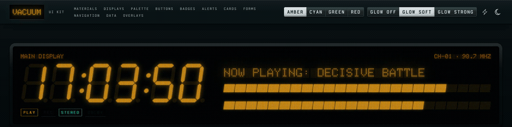

Switch between a black chassis and brushed silver daylight mode; the display glass stays dark.

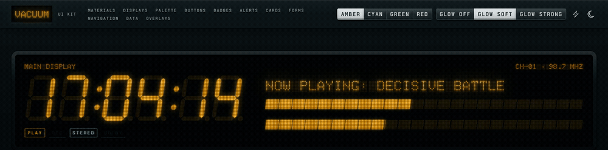

## Material language

- **Dark** is a black hi-fi chassis with silkscreened legends.
- **Daylight** is a brushed silver chassis with dark legends.
- **Display windows** are dark smoked glass with lit phosphor in both modes.

| Component | Material |
|---|---|
| Button, Kbd, Avatar, Pagination | Keycaps that travel when pressed; `subtle` keys carry an LED, `active` keys latch down |
| Checkbox | An illuminated push button: a tick printed on a tinted lens in a light-ringed housing; checking lights both |
| Radio group | Interlocking radio keys with indicator LEDs |
| Switch | A chrome toggle knob in a slot ringed by a light that comes on with it |
| Slider, Progress | A mixer fader over a glowing segmented LED trail and printed scale, and a segmented LED bar graph |
| Tabs | `pill`: latching source-selector keys in a recessed tray; legends are cut through the cap and lit from behind when latched, and a key without an icon carries an LED. `link`: a tuner dial with a sliding needle |
| Accordion | A stack of manila file folders; the open one shows a paper sheet filed inside |
| Table | A printout on continuous-feed green-bar paper |
| Input | A lit field. `outline` is a screen in a moulded frame, `soft` a screen flush in a rubber gasket, `subtle` a screen in a brushed steel bezel, `ghost` bare phosphor over a dashed printed rule, `none` bare phosphor. `highlight` lights a ring around it |
| Textarea | A teletype sheet on continuous-feed paper: sprocket holes, a printer's margin rule and ink text |
| Select, Select menu | A detented channel thumbwheel with a lit index window; the open menu is a small VFD screen |
| Input tags | A dark label-maker well; each tag is a cut chip of white tape with embossed letters, and new text is typed in the well |
| Pin input | A code on counter keys seated in a recessed tray; the focused key lights its ring and digit |
| Breadcrumb | A display window |
| Alert, Toast, Tooltip | Display windows with dot-matrix titles |
| Badge | Label-maker tape with embossed letters: dyed (`solid`), clear (`outline`), black (`soft`), white (`subtle`) |
| Card | Screens in a moulded frame; `solid` is lit edge to edge, `soft` is bare glass |
| Modal | A rack-mount module with rack ears and screws |
| Slideover | A drawer pulled out of the chassis: a brushed leading edge with a recessed finger pull, and a CLOSE key set into the faceplate |
| Dropdown menu, Select menus | A small VFD screen; the highlighted line inverts to dark text on lit phosphor |
| Popover | A paper note held by a steel gem clip whose outer loop wraps behind the sheet |

## Setup

```bash
bun add @fdcn/vacuum tailwindcss
```

```ts
// nuxt.config.ts
export default defineNuxtConfig({
  modules: ['@fdcn/vacuum'],
  css: ['~/assets/css/main.css'],
  vacuum: {
    phosphor: 'amber', // 'amber' | 'cyan' | 'green' | 'red'
    glow: 'soft', // 'off' | 'soft' | 'strong'
    prefix: 'V',
    font: true, // download and self-host Ioskeley Mono
  },
})
```

```css
/* app/assets/css/main.css */
@import "tailwindcss";
@import "@nuxt/ui";
@import "@fdcn/vacuum";
```

```vue
<!-- app.vue -->
<template>
  <UApp>
    <NuxtPage />
  </UApp>
</template>
```

Vacuum installs `@nuxt/ui` for you and defaults colour mode to dark.

## Typefaces

| Role | Face |
|---|---|
| Body, legends, fields (`font-sans`, `font-mono`) | [Ioskeley Mono](https://github.com/ahatem/IoskeleyMono) (OFL-1.1) |
| Silkscreened labels (`font-label`, `silkscreen`) | Ioskeley Mono semibold capitals |
| Headings (`font-heading`, `terminal`) | [VT323](https://fonts.google.com/specimen/VT323), from the DEC VT320 terminal (OFL-1.1) |
| Dot-matrix titles (`font-display`) | Doto (legacy; `matrix` now uses Vacuum Matrix) |
| Matrix text and icons (`matrix`, `matrix-icon`) | Vacuum Matrix, built from the same 5×7 glyph table as `VDotMatrix` |

Ioskeley Mono isn't on a font provider, so at build time Vacuum downloads five weights from the pinned `v2.2.0` release and serves them from `/_vacuum/fonts`, where `@nuxt/fonts` self-hosts them. Set `font: false` to skip the download.

## Icons

Nuxt UI's built-in icons (angle brackets, close, check, loading, alerts…) are mapped to the [Pixel Icon Library](https://pixeliconlibrary.com) by HackerNoon, licensed [CC BY 4.0](https://creativecommons.org/licenses/by/4.0/), which ships with the package as `@iconify-json/pixel`. Use any of its icons as `i-pixel-*`, for example `<UIcon name="i-pixel-cassette-tape" />`. The mapping lives in `src/runtime/icons.ts`; override any of it in your `app.config.ts` under `ui.icons`.

Icons render as inline SVG (`@nuxt/icon`'s `mode: 'svg'`) in the colour of the text beside them. A CSS-mask icon clips its own filter, so it couldn't glow the way the text next to it does.

Pixel icons are drawn on a 24-unit grid and only stay sharp when each art pixel covers whole device pixels. Vacuum sizes every icon to the grid for the screen: 12px on Retina (2×), 16px on 3×, 24px on standard displays. The rule is unlayered so it wins over `size-*` classes; set `--icon-units` to a multiple of 24 (for example `[--icon-units:48]`) for a larger icon.

Modal and slideover close keys spell out CLOSE in silkscreen (`legend-word`) instead of the mapped close glyph, so dismissing a panel reads as a hardware control rather than a UI close button. The legend is the key's accessible name, so it follows your locale.

`@nuxt/icon` finds collections installed under your app's or workspace's `node_modules`, which covers bun and npm installs. With pnpm's strict layout, add `@iconify-json/pixel` to your app's dependencies too, or the icons load from the Iconify API at runtime.

## Display components

```vue
<VSegmentDisplay value="12:45" size="xl" />
<VSegmentDisplay value="VACUUM" :segments="14" color="info" />
<VDotMatrix text="NOW PLAYING" />
<VMeter :value="72" :warning="0.7" :danger="0.9" />
<VAnnunciator label="Rec" color="error" active blink />
<VPanel title="Tuner" caption="98.7 MHz">…</VPanel>
```

Every display takes `color` (any Nuxt UI semantic colour) and `size`. Segment and dot-matrix displays also accept `ghost`, `blink` and `warmup`.

## Performance

Displays keep their node count fixed. `VDotMatrix` paints the unlit grid with a single pattern and every lit dot as one path, and `VMeter` paints its whole bar graph as a segmented gradient with one glow. A twelve-channel meter bank mounts about forty nodes instead of three hundred, so opening a panel no longer forces a style recalculation over hundreds of children.

Reka, Nuxt UI's overlay engine, sets `pointer-events: none` on `<body>` while a modal layer is open. The property inherits, so that one change recalculates the style of every element on the page — tens of milliseconds on a long page. Vacuum keeps the body interactive instead (`body:where([data-scroll-locked], [style*="pointer-events: none"]) { pointer-events: auto !important }`). The full-screen overlay still takes input, so outside clicks and focus trapping are unchanged.

## Runtime switching

```ts
const { phosphor, glow } = useVacuum()
phosphor.value = 'cyan'
glow.value = 'strong'
```

## Utilities

Every component theme is a composition of these utilities; the showcase's Materials section shows each on its own.

| Class | Effect |
|---|---|
| `chassis` | Raised panel: black in dark mode, brushed silver in daylight |
| `keycap` | Plastic key that travels on press; colour comes from its background. Latches with `.latched`, `aria-pressed`, `aria-checked` or `data-state="on/active/checked"`; `latch-on-checked` latches when a control inside is checked |
| `knurled`, `knurled-y` | Moulded grip grooves at a keycap's centre |
| `dished`, `dished-y` | A concave keycap top |
| `window` | Smoked display glass; Nuxt UI text and colour tokens inside it read as lit phosphor |
| `screen`, `screen-lit` | Glass set in a moulded plastic frame on one element, corners concentric; `screen-lit` is lit edge to edge |
| `screen-flush`, `screen-steel` | The same glass set flush in a rubber gasket, or in a brushed steel bezel |
| `field-bare`, `field-dashed` | A field with no housing, or with a dashed printed rule, at the same outer geometry as a framed field |
| `bezel` | Moulded plastic frame around any child, whose corners follow the frame's (`--bezel`, `--bezel-radius`) |
| `recess` | Recessed slot or groove |
| `thumbwheel` | A detented selector drum in a well, with a lit index window and a printed scale at both rims |
| `paper`, `manila`, `ink` | Paper stock (`--paper`) printed in ink; `ink` alone re-points text tokens to ink and defines `--highlighter` |
| `tractor-feed`, `greenbar` | Continuous-feed margins with holes and perforations; alternating green rows |
| `teletype` | A printer's margin rule just inside `tractor-feed` holes |
| `folder-stack`, `folder`, `folder-tab`, `folder-face` | Stacked file folders with staggered tabs stepping down in a staircase; only tabs and open faces take clicks; the `data-state="open"` folder shows its face, and `paper` inside it is white sheet stock cut with square corners |
| `rack` | Rack-mount faceplate with ears and screws (`--rack-ear`) |
| `rails`, `rails-y` | Telescopic drawer runners top and bottom, or on the sides (`--rail`) |
| `drawer`, `drawer-front-{left,right,top,bottom}` | A drawer with a brushed metal leading edge, recessed finger pull and inset content (`--drawer-front`) |
| `inset-key` | A key seated in a recessed well, as for an eject or close key |
| `legend-word` | A silkscreened key legend taken from the element's `aria-label` |
| `label-tape`, `embossed` | Label-maker tape (`--tape`, `--tape-ink`) and raised lettering (`--emboss` edge colour) |
| `metal` | Polished metal for knobs and levers |
| `light-ring`, `light-ring-on` | An illuminated ring around a control's housing, dim and lit |
| `lens`, `lens-lit` | A tinted lens over a lamp, unlit and glowing; `lens` composes with `keycap` |
| `legend-check` | A tick printed on a key, always present like a real legend (`--legend-ink`) |
| `punched` | Binder punch holes down a sheet's left margin |
| `note` | Paper held by a gem clip — inner loop in front, outer loop around the back — set down slightly askew |
| `silkscreen` | Printed chassis label in terminal capitals |
| `terminal` | Heading in VT323 terminal capitals |
| `led`, `led-on` | Indicator LED (`--led-size`), unlit and lit; works on `before:`/`after:` |
| `needle`, `needle-y` | Glowing index line across a positioned element's centre |
| `scale`, `scale-y` | Printed tick marks (`--scale-step`, `--scale-height`) |
| `segments`, `segments-y` | Cut an element into bar-graph segments |
| `led-bar`, `led-bar-y` | Paint bar-graph segments as background, so their glow is not clipped by a mask |
| `glow`, `glow-box`, `glow-svg` | Phosphor glow on text, boxes and SVG; icons inside `glow` text bloom by the same amount |
| `glow-icon` | The text glow, for an icon beside glowing text |
| `matrix` | Sets any text in Vacuum Matrix, with the unlit dot grid painted behind it; keep the font size a multiple of 8px for crisp dots (16px gives a 2px pitch) |
| `matrix-icon` | Redraws a pixel icon as a dot matrix, one dot per art pixel, at a pitch matched to the screen |
| `etched`, `etched-lit` | A key legend cut through the cap, unlit, and backlit with light leaking through; icons in the legend follow it |
| `ghost` | Unlit segment tint |
| `mesh` | Control-grid overlay |
| `animate-vfd-warmup`, `animate-vfd-flicker`, `animate-vfd-blink` | Tube animations; pair with `motion-safe:` |

Glow and LEDs follow the `--vfd` colour of the nearest themed component. Materials write Tailwind's `--tw-shadow`, so they compose with `ring-*` and `glow-box`, and replace `shadow-*` when classes merge.

## Customising

The theme is a preset in `app.config` (`ui.button`, `ui.card`, …), so your own `app/app.config.ts`, the `ui` prop and `class` override it as usual in Nuxt UI.

## Development

```bash
bun install
bun run dev        # playground with the showcase page
bun run lint
bun run test
bun run test:types
bun run prepack    # build dist
```

The 14-segment table and the 5×7 dot-matrix font come from Adafruit's [LED Backpack](https://github.com/adafruit/Adafruit_LED_Backpack) (MIT) and [GFX](https://github.com/adafruit/Adafruit-GFX-Library) (BSD-2-Clause) libraries.

## License

MIT. Third-party notices are in [THIRD-PARTY-NOTICES](THIRD-PARTY-NOTICES).
